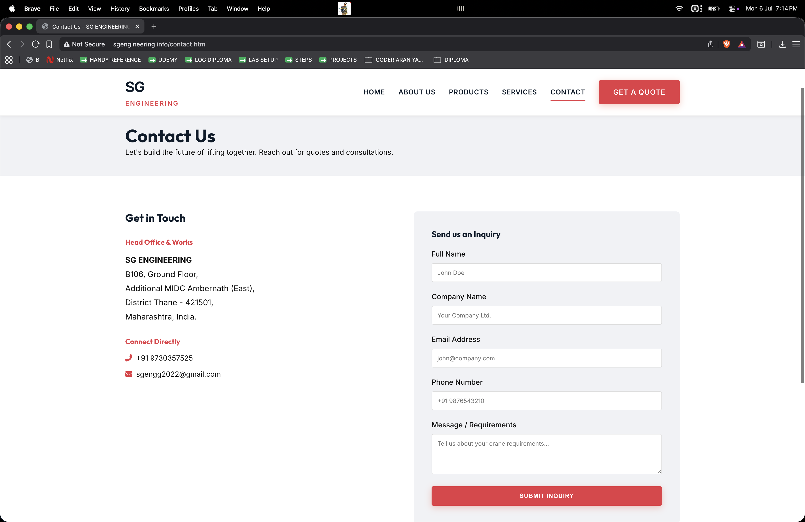
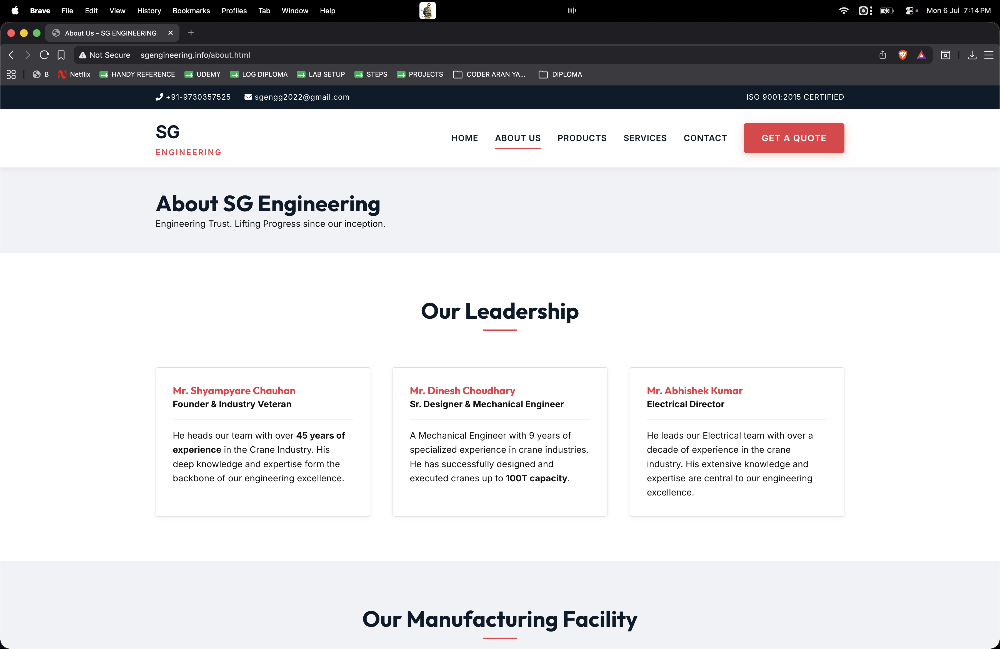

# SG Engineering 🏗️

[](https://sgengineering.vercel.app)
[](https://sgengineering.vercel.app/about)
[](LICENSE)
[](http://sgengineering.info)

> **Engineering Trust. Lifting Progress.**  
> Official repository for **SG Engineering**, a premier provider of industrial lifting solutions in India. Specializing in the end-to-end design, precision engineering, heavy manufacturing, commissioning, and IoT modernization of industrial cranes and hoists.

---

## 🌐 Live Deployments

- **Primary Vercel Production:** [https://sgengineering.vercel.app](https://sgengineering.vercel.app)
- **Official Domain:** [http://sgengineering.info](http://sgengineering.info)

---

## 📸 Website Preview

| Home Page | Products Showcase |
| :---: | :---: |
| [](https://sgengineering.vercel.app) | [](https://sgengineering.vercel.app/products) |
| **About Us & Facility** | **Contact & Inquiries** |
| [](https://sgengineering.vercel.app/about) | [](https://sgengineering.vercel.app/contact) |

---

## 🚀 About SG Engineering

Established with an uncompromising commitment to engineering excellence, safety, and reliability, **SG Engineering** stands as a trusted leader in India's heavy lifting industry. With over **200+ successful crane installations** nationwide, we deliver turnkey solutions tailored to metallurgical plants, manufacturing units, warehouses, shipyards, and heavy infrastructure projects.

### 🏭 Manufacturing Infrastructure
- **Location:** MIDC Additional Ambernath, Maharashtra (Mumbai Industrial Corridor).
- **Floor Area:** 2,000+ Sq. Mtrs. dedicated manufacturing shop.
- **Handling Equipment:** Equipped with 2 Nos. 10T EOT internal handling cranes.
- **Machinery:** Metal cutting machines, submerged arc & MIG welding setups, heavy radial drills, lathes, and custom structural fabrication beds.
- **Compliance Standards:** Built strictly conforming to **IS 3177** and **IS 807** standards with **ISO 9001:2015** quality assurance.

### 👥 Leadership Team
- **Mr. Shyampyare Chauhan** — *Founder & Industry Veteran* (45+ years of crane industry leadership).
- **Mr. Dinesh Choudhary** — *Sr. Designer & Mechanical Engineer* (Specialist in cranes up to 100T capacity).
- **Mr. Abhishek Kumar** — *Electrical Director* (Decade+ specialized experience in heavy automation and motor control).

---

## 🛠️ Products & Systems

| Product | Series | Capacity / Highlights |
| :--- | :--- | :--- |
| **EOT Cranes** | *SG-EOT Master* | Single & Double Girder, heavy duty factory crane systems. |
| **Goliath / Gantry Cranes** | *SG-Goliath Pro* | Full-Gantry and Semi-Gantry configurations for outdoor and heavy fabrication yards. |
| **Jib Cranes** | *SG-JIB Assist* | 360° rotating workstation cranes for confined spaces and localized material loading. |
| **Electric Hoists** | *SG-Hoist Power* | Electric Wire Rope and Chain Hoists for high-duty continuous operation. |
| **Transfer Trolleys** | *SG-TransTrolley* | Heavy-duty rail and floor transfer trolleys (Flameproof & Normal Duty). |
| **Specialized Cranes** | *SG-Custom* | Monorail systems, underslung cranes, and custom material handling solutions. |
| **Smart IoT Cranes** | *SG-Lift360* | Real-time sensor monitoring, vibration analysis, load tracking, and fault diagnostics. |

---

## 🔧 Engineering Services

1. **Custom Design & Manufacturing:** Precision mechanical and finite element analysis (FEA) based design backed by extensive computerized engineering data banks.
2. **Erection & Commissioning:** Turnkey on-site installation, gantry girder alignment, busbar setup, and functional testing.
3. **Retrofitting & Modernization:** Refurbishment of legacy cranes, replacing mechanical wear components and installing modern VFDs and smart remotes.
4. **Annual Maintenance Contracts (AMC):** AMC Shield preventive maintenance programs to guarantee near-zero unplanned downtime.
5. **Specialized Load Testing:** Proof load testing with calibrated load cells up to 125% of rated capacity (e.g., 13.5T testing on 10T cranes) across hoist, cross travel, and long travel motions.

---

## 💻 Tech Stack & Architecture

- **Frontend:** Semantic HTML5, Modular CSS3 (Custom Properties & Responsive Grid/Flexbox), Vanilla JavaScript (Zero bloated runtime dependencies).
- **Icons & Fonts:** FontAwesome 6, Google Fonts (`Outfit` + `Inter`).
- **Branding Assets:** Custom SVG favicon, high-resolution product photography, and responsive media queries.
- **Deployment & Hosting:** [Vercel](https://vercel.com) Edge Network with custom HTTP security headers and immutable asset caching.
- **SEO & Social:** OpenGraph Protocol and Twitter Card meta integration across all pages.

---

## 📁 Repository Structure

```text
.
├── assets/                  # High-resolution imagery, previews, and SVG favicon
│   ├── about.png
│   ├── contact.png
│   ├── electric_hoist.png
│   ├── eot_crane.png
│   ├── facility.png
│   ├── favicon.svg          # Custom engineering crane icon
│   ├── goliath_crane.png
│   ├── home.png
│   ├── iot_crane.png
│   ├── jib_crane.png
│   ├── monorail_crane.png
│   ├── products.png
│   └── transfer_trolley.png
├── css/
│   └── style.css            # Core responsive stylesheet with theme tokens
├── js/
│   └── script.js            # Navigation toggle, counter animation, form UX
├── .gitignore               # Ignored build & system files
├── CNAME                    # Custom domain mapping (sgengineering.info)
├── LICENSE                  # MIT License
├── README.md                # Project documentation
├── about.html               # Company history, leadership, and plant specifications
├── contact.html             # Inquiry form, location details, direct contact info
├── index.html               # Landing page with hero, statistics, and highlights
├── products.html            # Complete industrial lifting products catalog
├── services.html            # Maintenance, retrofitting, and testing services
└── vercel.json              # Vercel production deployment and header configuration
```

---

## ⚡ Local Development

To run the project locally on your machine:

1. **Clone the repository:**
   ```bash
   git clone https://github.com/Coderaryanyadav/SgEngineering.git
   cd SgEngineering
   ```

2. **Open directly or run with any local HTTP server:**
   ```bash
   # Using Python 3
   python3 -m http.server 3000

   # Or using npx serve
   npx serve .
   ```

3. Open your browser and navigate to `http://localhost:3000`.

---

## 🚀 Deployment

### Deploy to Vercel

The project is preconfigured with `vercel.json` for automatic deployments on push to `main`:

```bash
# Deploy to preview
npx vercel

# Deploy directly to production
npx vercel --prod
```

### GitHub Pages (Alternative)

This repository is also fully compatible with GitHub Pages:
1. Navigate to repository **Settings** > **Pages**.
2. Select `Deploy from a branch` and choose `main` branch with `/ (root)`.
3. The custom domain is automatically configured via the included `CNAME` file.

---

## 📞 Contact Information

- **Works & Head Office:** B106, Ground Floor, Additional MIDC Ambernath (East), District Thane - 421501, Maharashtra, India
- **Phone:** [+91 9730357525](tel:+919730357525)
- **Email:** [sgengg2022@gmail.com](mailto:sgengg2022@gmail.com)
- **Website:** [https://sgengineering.vercel.app](https://sgengineering.vercel.app) | [http://sgengineering.info](http://sgengineering.info)

---

<div align="center">
  <b>Built in India, Lifting the World 🇮🇳</b><br>
  <sub>© SG ENGINEERING. All Rights Reserved. | ISO 9001:2015 Certified</sub>
</div>
